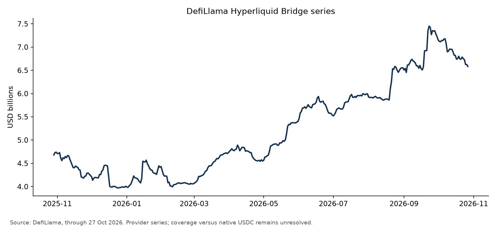
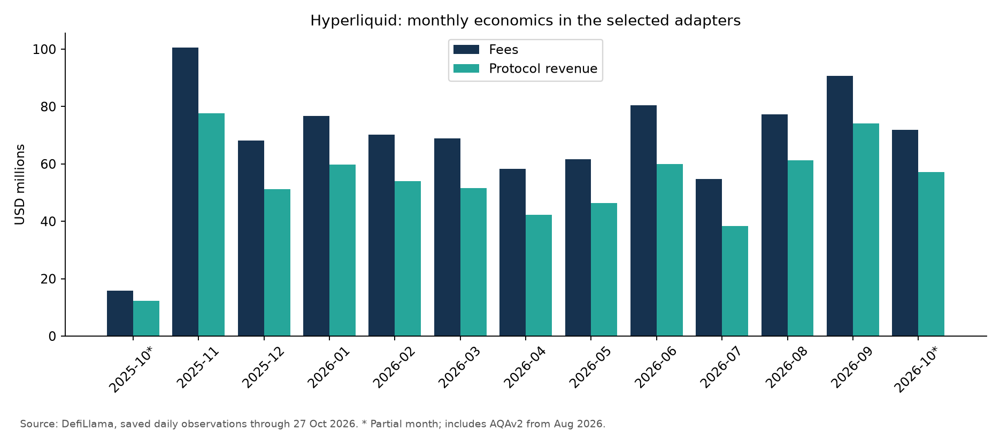
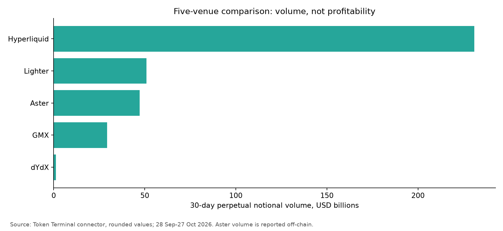
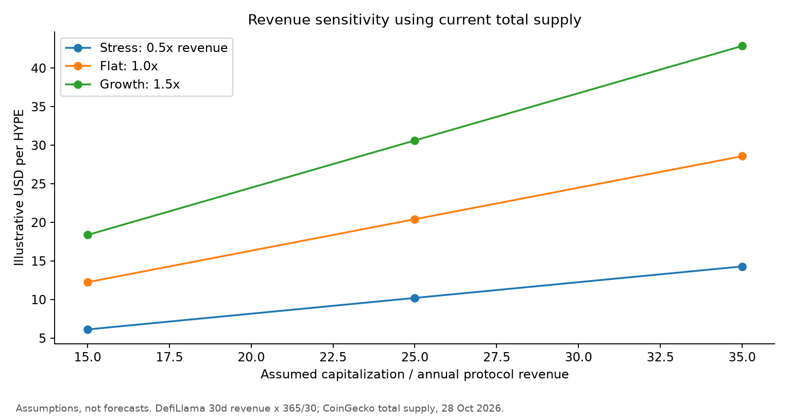

# Hyperliquid: фундаментальный анализ протокола и HYPE

**Дата исследования: 28 октября 2026 года.** Экономические ряды заканчиваются 27 октября; котировка и предложение HYPE — снимок 28 октября, 20:48 UTC / 23:48 МСК. Источники: DefiLlama через DeFi Analyst, CoinGecko, Token Terminal и документация Hyperliquid.

**Вывод: положительная оценка работающего бизнеса, сдержанная оценка HYPE при текущей цене.** У протокола есть значимый доход и механизм покупки и сжигания токена. Однако оценка будущего предложения существенно выше капитализации обращения, последние 30 дней слабее предыдущих, а рост дохода частично связан с новой статьёй — резервами стейблкоинов. Оснований автоматически считать HYPE дешёвым нет.

Главный вопрос исследования: **сможет ли Hyperliquid наращивать доход и покупки HYPE быстрее, чем растёт доступное рынку предложение токена?** Текущий набор данных позволяет оценить экономику, но не даёт полного ответа о чистом изменении обращения.

## 1. Что представляет собой Hyperliquid

Hyperliquid объединяет собственный блокчейн и торговую инфраструктуру. HyperCore исполняет торговые операции, а HyperEVM позволяет запускать совместимые с Ethereum приложения. Такое устройство связывает биржу, ликвидность и приложения, но создаёт общую зависимость от консенсуса и исполнения сети. [Документация проекта](https://hyperliquid.gitbook.io/hyperliquid-docs), [HyperEVM](https://hyperliquid.gitbook.io/hyperliquid-docs/for-developers/hyperevm).

Для анализа нужно различать:

| Объект | Экономический смысл |
|---|---|
| Perps | Бессрочные фьючерсы; объём номинальный, с учётом плеча |
| Spot | Покупка и продажа самих активов |
| HLP | Хранилище ликвидности с торговыми стратегиями и риском убытков |
| HyperEVM | Исполнение приложений и газовые комиссии |
| USDC reserve / AQAv2 | Доход от резервов, отличающийся от торговых комиссий |
| HYPE | Токен сети; его держатель не получает договорного права на всю выручку |

Сумма TVL моста, HLP, кредитных приложений и всей сети может повторно учитывать одни и те же активы. В этом исследовании они не складываются.

## 2. Ключевые показатели

Основной расчётный контур — **адаптер DefiLlama Hyperliquid Perps плюс отдельный Spot Orderbook**. Название Perps здесь не означает чистую торговую выручку: адаптер включает builder fees и доход AQAv2 с 27 августа 2026 года. HyperEVM и Outcomes отдельно к этому контуру не добавлялись. Сохранённые ответы и адреса API находятся в data/raw.

| Показатель | Значение | Период / смысл |
|---|---:|---|
| Perps fees | $77,85 млн | 28.09–27.10.2026; контур адаптера |
| Perps protocol revenue | $62,19 млн | Тот же период |
| Spot fees | $2,19 млн | Тот же период |
| Spot protocol revenue | $1,68 млн | Тот же период |
| Суммарные fees выбранного контура | $80,04 млн | Не чистый торговый доход |
| Суммарная protocol revenue | $63,87 млн | Не чистая прибыль и не измеренные покупки |
| Доля revenue в fees | 79,8% | Расчёт по одинаковому контуру |
| Revenue за последние 365 дней | $686,23 млн | 28.10.2025–27.10.2026 |
| Годовой темп revenue по 30 дням | $777,09 млн | 30d × 365 / 30, не прогноз |
| HYPE | $80,52 | CoinGecko, 28.10.2026 |
| Рыночная капитализация обращения | $19,28 млрд | Снимок CoinGecko |
| FDV поставщика | $76,62 млрд | Оценка на базе total supply, округлённый снимок |
| MCap / годовой темп revenue | 24,8× | Не P/E |
| FDV / годовой темп revenue | 98,6× | Не P/E |
| MCap / trailing 365d revenue | 28,1× | Не P/E |

Источники: [DefiLlama Perps](https://defillama.com/protocol/hyperliquid-perps), [DefiLlama Spot](https://defillama.com/protocol/hyperliquid-spot-orderbook), [CoinGecko HYPE](https://www.coingecko.com/en/coins/hyperliquid). Точные значения и формулы — в data/processed/summary.json и economics.csv.

Средства в серии DefiLlama «Hyperliquid Bridge» составляют $6,58 млрд на 27 октября и около $6,61 млрд во внутридневном снимке 28 октября. **Это метрика поставщика с неразрешённым вопросом покрытия.** Актуальная документация сообщает о нативном USDC и о том, что старый мост Arbitrum содержит менее 10% USDC на HyperCore. Поэтому ряд нельзя без проверки адаптера называть балансом старого моста или всеми депозитами клиентов. [Текущая документация USDC](https://hyperliquid.gitbook.io/hyperliquid-docs/hypercore/usdc), [серия DefiLlama](https://defillama.com/protocol/hyperliquid-bridge).

Изменения за 7 и 30 дней рассчитываются по закрытым дням и сохраняются в summary.json. Два наблюдения за незавершённое 28 октября оставлены в исходном ответе и исключены из дневных расчётов.



## 3. Доходные продукты: что получает вкладчик

HLP занимается предоставлением ликвидности, ликвидациями и другими стратегиями; его результат зависит от торгового PnL, а не только от комиссии. Текущая документация указывает четырёхдневную блокировку после последнего депозита. Стабильная доходность в долларах не гарантируется. [Protocol vaults](https://hyperliquid.gitbook.io/hyperliquid-docs/hypercore/vaults/protocol-vaults).

Для стейкинга HYPE вознаграждения поступают из резерва будущей эмиссии; это не распределение торговой выручки. Документация описывает очередь вывода из стейкинга в семь дней. Пример ставки 2,37% при 400 млн HYPE в стейкинге — параметр формулы, а не текущая измеренная доходность. [Staking](https://hyperliquid.gitbook.io/hyperliquid-docs/hypercore/staking).

Сопоставимой текущей выборки из 3–5 пулов по TVL и APY не получено. Рейтинг доходностей не строится; актуальный HLP PnL и APY не подменяются цифрами из рекламы или старых публикаций.

## 4. Откуда поступает доход

По отдельной классификации Token Terminal за 28 сентября — 27 октября:

| Продукт | Fees | Protocol revenue |
|---|---:|---:|
| Perps | ~$65,8 млн | ~$52,1 млн |
| USDC reserve | ~$20,9 млн | ~$16,2 млн |
| Spot | ~$1,81 млн | ~$1,74 млн |
| HyperEVM | ~$0,519 млн | ~$0,519 млн |
| Outcomes | ~$0,083 млн | ~$0,043 млн |
| Всего по данным поставщика | ~$89,0 млн | ~$70,6 млн |

Данные округлены в ответе коннектора; сумма строк может слегка отличаться от итоговой цифры. Исходный ответ сохранён в [tt.md](../data/raw/tt.md). Числа Token Terminal не добавляются к цифрам DefiLlama.

При такой классификации perps дают около 74% revenue, а USDC reserve — около 23%. HyperEVM остаётся небольшой статьёй текущего дохода. Это поддерживает взгляд на Hyperliquid прежде всего как на торговую платформу с дополнительной экономикой резервов, хотя будущие приложения могут изменить структуру.

AQAv2 предусматривает передачу протоколу примерно 90% доходности резервов после соответствующей корректировки затрат. По документации доход начисляется 30-дневными интервалами и направляется в Assistance Fund через восемь дней после окончания интервала. Поэтому начисленный доход и покупки HYPE в том же календарном окне могут различаться. [Aligned quote assets](https://hyperliquid.gitbook.io/hyperliquid-docs/hypercore/aligned-quote-assets).

Отсюда три ограничения оценки:

- Новый доход от резервов нельзя считать доказательством роста торгового спроса.
- Модель reserve income чувствительна к объёму соответствующих стейблкоинов, ставкам и условиям партнёров.
- Protocol revenue не равна подтверждённой чистой прибыли: полных операционных затрат и согласованного отчёта о net income нет.

Даже если агрегатор подписывает строку «earnings» равной revenue, это не подтверждает отсутствие расходов.



По сохранённым ежедневным данным DefiLlama perps fees за последние 30 дней снизились на 10,1% относительно предыдущих 30 дней, revenue — на 12,4%. Для spot снижение составило 18,9% и 22,8%. У Token Terminal для всего проекта падение fees составляет около 4%, revenue — около 7%. Направление одинаковое; проценты различаются из-за контура и методики.

## 5. Пользователи и конкуренция

Token Terminal возвращает примерно **83,3 тыс. активных адресов, совершающих доходообразующие операции, в среднем за день** за 30 дней. Это почти не изменилось против предыдущего периода; среднее за 90 дней выросло примерно на 20%. Число относится к определению поставщика для проекта. Оно не является отдельно проверенным числом уникальных трейдеров perps или физических лиц.

Открытый интерес — около $7,83 млрд на 27 октября. Это остаток открытых позиций в конкретный момент; его нельзя суммировать по дням как выручку или объём торгов.

Для конкурентов использован один источник и одинаковое окно:

| Площадка | Perps volume, 30d | Доля в выбранной пятёрке |
|---|---:|---:|
| Hyperliquid | ~$231 млрд | 64,2% |
| Lighter | ~$50,9 млрд | 14,2% |
| Aster | ~$47,2 млрд | 13,1% |
| GMX | ~$29,3 млрд | 8,1% |
| dYdX | ~$1,17 млрд | 0,3% |

Доли пересчитаны по округлённым объёмам. Это **доли внутри выбранной группы**, а не всего рынка. По ответу Token Terminal объём Aster представлен как off-chain reported data, что снижает сопоставимость происхождения данных. Incentives, rebates, wash trading и глубина исполнения не исследованы на уровне отдельных сделок.



DefiLlama показывает для Hyperliquid около $206,19 млрд объёма за 30 дней и $7,822 млрд OI в просмотренном снимке. Расхождение объёма с Token Terminal — около 12%. Оно не устранено сопоставлением отдельных сделок; выбрать одно значение как бесспорную истину нельзя. Для сравнительной таблицы использован только Token Terminal; для основной модели дохода — только DefiLlama.

Исследовательская гипотеза конкурентного преимущества: ликвидность, исполнение и приложения могут удерживать пользователей и привлекать создателей новых рынков. Проверять её следует через удержание трейдеров, глубину стакана и revenue на единицу объёма. Одного лидерства по номинальному обороту недостаточно.

## 6. Изменения продукта и история рисков

На дату проверки официальная документация описывает HIP-3: независимые создатели могут запускать рынки, определять их параметры и оракулы. Указанное требование — 500 тыс. HYPE в стейкинге. Это создаёт спрос на токен, но одновременно повышает важность качества рынков и действий их операторов. Параметр может измениться. [HIP-3](https://hyperliquid.gitbook.io/hyperliquid-docs/hyperliquid-improvement-proposals-hips/hip-3-builder-deployed-perpetuals).

AQAv2 и переход к нативному USDC меняют доходную модель и инфраструктуру. Дату включения reserve yield 27 августа использует методика DefiLlama; это дата учёта источника, а не независимо доказанная дата всех изменений продукта.

В марте 2025 года эпизод с JELLY показал риск манипуляций малоликвидным рынком и вмешательства валидаторов в его закрытие. Он раскрывается в [проспекте Bitwise](https://s3.us-east-1.amazonaws.com/static.bitwiseinvestments.com/bhyp/BHYP-Bitwise-Hyperliquid-ETF-Prospectus.pdf). Нереализованные убытки в ходе эпизода не следует выдавать за окончательную потерю средств. Это исторический пример рыночного и управленческого риска; полной хронологии всех инцидентов и проверенного списка взломов здесь нет.

Сведения о финансировании команды и отсутствии VC не используются как доказанный инвестиционный аргумент: отдельная проверка корпоративного финансирования не проведена.

## 7. HYPE: предложение и механизм накопления стоимости

По сохранённому снимку CoinGecko:

| Показатель | HYPE |
|---|---:|
| В обращении | 239,41 млн |
| Текущее total supply | 951,54 млн |
| Первоначальный максимальный лимит | 1 млрд |
| Обращение / total supply | 25,16% |
| Обращение / первоначальный лимит | 23,94% |

Разница между total supply и обращением **не означает**, что все остальные токены будут проданы в ближайшее время. Но оценка только по обращению даёт неполную картину. После сжиганий текущее total supply также отличается от первоначального лимита.

Согласно документации, Assistance Fund автоматически конвертирует торговые комиссии в HYPE; токены фонда считаются сожжёнными. Газ HyperEVM также предусматривает сжигание. Покупки на рынке поддерживают спрос, но результат зависит от цены исполнения, доступного предложения и общего спроса. [Fees](https://hyperliquid.gitbook.io/hyperliquid-docs/trading/fees), [HyperEVM](https://hyperliquid.gitbook.io/hyperliquid-docs/for-developers/hyperevm).

Нельзя применять утверждение «99% комиссий» ко всей строке gross fees: часть относится к builder/deployer distributions и другим потокам. Фактический retained share выбранного контура в этом окне около 79,8%.

В [годовом раскрытии Hyperliquid Strategies](https://www.sec.gov/Archives/edgar/data/2078856/000119312526412579/d168610dars.pdf) описаны 23,8% первоначального предложения для core contributors и ежемесячный vesting, начавшийся в ноябре 2025 года. Это раскрытие сторонней публичной компании, а не независимая проверка каждого кошелька команды.

CoinGecko указывает следующую разблокировку 6 ноября 2026 года — около 9,92 млн HYPE. Это **индикативное расписание стороннего поставщика**. Оно не сверено с кошельками и условиями vesting; разблокировка не равна немедленной продаже.

Для вывода о чистом изменении обращения нужны фактические покупки и сжигания, эмиссия наград, движение разблокированных токенов и применяемое определение circulating supply. Эти ряды не получены. Поэтому вывод «buyback полностью перекрывает dilution» не делается.

## 8. Оценка и чувствительность

На базе DefiLlama текущий годовой темп protocol revenue равен примерно $777 млн. Отношение этого дохода к капитализации обращения составляет **4,03%**, но это не дивидендная доходность, не ставка стейкинга и не измеренная доходность выкупа.

MCap / revenue run-rate около 24,8× выглядит существенно мягче, чем FDV / run-rate около 98,6×. Такая разница показывает чувствительность инвестиционного тезиса к предложению. Годовой темп по данным всего проекта Token Terminal дал бы другие мультипликаторы; в основной модели источники не смешиваются.

В таблице ниже используются произвольные сценарные допущения. Формула: годовая protocol revenue × заданный мультипликатор / количество токенов. Это не DCF, не оценка акционерного капитала и не целевая цена.

| Сценарий | Годовая revenue | Мультипликатор | Капитализация | Цена при текущем обращении | При текущем total supply |
|---|---:|---:|---:|---:|---:|
| Стресс: 0,5× текущего темпа | ~$389 млн | 15× | ~$5,83 млрд | ~$24 | ~$6 |
| Без роста: 1,0× | ~$777 млн | 25× | ~$19,43 млрд | ~$81 | ~$20 |
| Рост: 1,5× | ~$1 166 млн | 35× | ~$40,80 млрд | ~$170 | ~$43 |

В последней колонке та же капитализация делится на большее предложение. Это **арифметическая чувствительность**, а не прогноз полной разблокировки завтра. Не моделируются будущие сжигания, календарь эмиссии, операционные расходы, ставка дисконтирования и отдельная стоимость приложений. Полная сетка 3 × 3 и вариант с первоначальным лимитом — в valuation_scenarios.csv.



## 9. Основные риски и что отслеживать

| Риск | Почему влияет на оценку | Проверяемый показатель |
|---|---|---|
| Конкуренция и снижение ставки комиссии | Больший объём может давать меньше дохода | Чистые торговые fees / объём, без reserve yield |
| Emissions и разблокировки | Растёт потенциальное рыночное предложение | Изменение обращения, реальные покупки и burns |
| Зависимость от reserve income | Падение ставок или остатков снижает доход | USDC supply, реализованный AQA rate и платежи |
| Ликвидации и малоликвидные рынки | Накопление токсичной позиции и убытки HLP | OI относительно глубины, концентрация позиций |
| Валидаторы и управление | Возможность вмешательства и остановки | Концентрация stake, изменения параметров |
| Оракулы и HIP-3 операторы | Ошибочная цена влияет на расчёты и ликвидации | Источники цены, лимиты и инциденты по рынкам |
| Инфраструктура USDC и приложения | Несколько взаимосвязанных уровней риска | Аудиты, доступность переводов, концентрация обеспечения |
| Качество данных | Несопоставимые метрики и двойной счёт | Сверка контуров, cutoff, методик и дневных наблюдений |

Это исследовательские риски, а не юридические выводы о статусе продукта. Наличие [аудита моста](https://hyperliquid.gitbook.io/hyperliquid-docs/audits) не покрывает автоматически всю экономику рынков и приложения HyperEVM.

Положительный сценарий станет убедительнее, если торговая revenue будет расти без опоры только на reserve income, удержание пользователей улучшится, а подтверждённые покупки и сжигания будут сопоставлены с эмиссией. Негативный сигнал — одновременное снижение монетизации и удержания на фоне роста обращения.

## 10. Сопоставление с Aave

| Вопрос | Aave | Hyperliquid |
|---|---|---|
| Базовый спрос | Заёмная ликвидность | Торговля и инфраструктура рынков |
| Рабочие показатели | Borrow demand, utilization, reserve factor | Volume, OI, активные трейдеры, комиссия |
| Доход протокола | Удерживаемая часть процентов и другие потоки | Торговые потоки, reserve income, газ и другие продукты |
| Переход к токену | Требует отдельной проверки текущих решений DAO | Работающий Assistance Fund и сжигание |
| Главный вопрос модели | Сколько дохода остаётся после расходов DAO | Как доход и покупки соотносятся с новым предложением |

Сравнение описывает бизнес-модели. Старые числа из проекта Aave не используются как текущая оценка рынка 28 октября.

## 11. Ограничения и воспроизводимость

Исследование — фиксированный снимок. DefiLlama выбран для ежедневных расчётов; Token Terminal — для продуктовой классификации и единой группы конкурентов; CoinGecko — для котировки и предложения. Расхождения сохранены, а не усреднены.

Не получены: подтверждённые покупки HYPE за окно, полный отчёт расходов, точный net issuance, история удержания трейдеров, проверенная текущая доходность HLP и полная сверка native USDC с серией Bridge. Эти пробелы ограничивают силу инвестиционного вывода.

Повторный запуск не требует сети:

```sh
python3 -m pip install -r requirements.txt
python3 run_analysis.py --offline
python3 -m unittest discover -s tests -v
```

Первая команда устанавливает библиотеку графиков и требует доступа к пакетам, если она ещё не установлена. Сам расчёт полностью локальный. Для актуализации нужны новые снимки и новая проверка методик; автоматического live-refresh нет.

Исходные ответы: data/raw. Расчёты: data/processed. Графики: charts. Реестр источников и ограничений: [SOURCES.md](../SOURCES.md).
